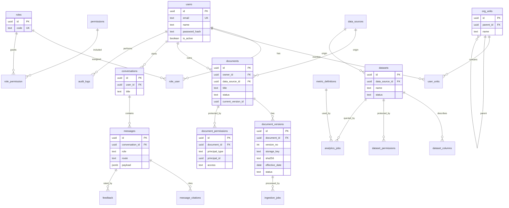
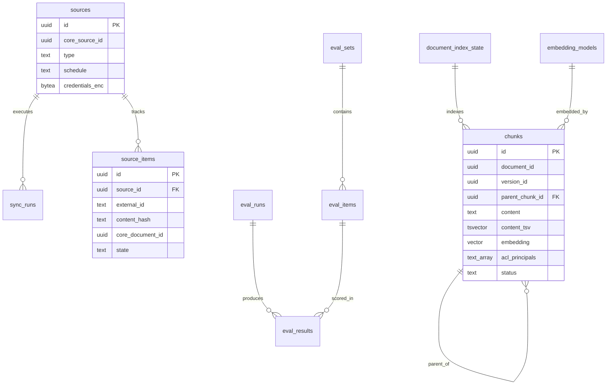

# FINAL DATABASE DESIGN — EKAA

| Atribut | Nilai |
|---|---|
| Versi dokumen | 1.0-draft (Gelombang 2) |
| Tanggal pembaruan | 8 November 2026 |
| Status dokumen | **READY FOR OWNER APPROVAL** |
| Dokumen terkait | `FINAL_SYSTEM_ARCHITECTURE.md` (bagian 8), `FINAL_API_SPECIFICATION.md`, `FINAL_SECURITY_SPECIFICATION.md`, `FINAL_DECISION_REGISTER.md` (DEC-007, DEC-008, DEC-025 s.d. DEC-027, DEC-029) |

## 1. Keputusan Desain

| ID | Keputusan | Alasan |
|---|---|---|
| DD-01 | Satu PostgreSQL, tiga schema (`core`, `connector`, `ai`), tiga role (DEC-007) | Kepemilikan jelas tanpa banyak instans |
| DD-02 | Kunci primer `uuid` (UUIDv7 dari aplikasi) (DEC-026) | Referensi lintas layanan tanpa sequence bersama; urutan waktu baik untuk indeks |
| DD-03 | Tidak ada tabel `organizations` (DEC-027) | Single-tenant: tidak ada kolom `organization_id` di setiap tabel. Profil organisasi di `core.system_settings` |
| DD-04 | Foreign key hanya **di dalam** satu schema. Referensi lintas schema berupa kolom UUID tanpa FK | Mencegah ketergantungan migrasi antarlayanan |
| DD-05 | Integritas lintas schema dijaga rekonsiliasi harian (Laravel) dan aturan hapus lunak | Mendeteksi yatim (orphan) |
| DD-06 | Hapus lunak (`deleted_at`) untuk dokumen, dataset, pengguna; log audit tidak pernah dihapus lewat aplikasi | Auditabilitas dan retensi |
| DD-07 | Dimensi vektor mengikuti model embedding terpilih (DEC-014). Dimensi ditulis pada migrasi M0 setelah model dikunci | Dimensi tidak boleh diasumsikan |
| DD-08 | Waktu disimpan `timestamptz` (UTC) | Konsistensi |

## 2. Kepemilikan per Layanan

| Schema | Role DB | Hak | Pemilik migrasi |
|---|---|---|---|
| `core` | `ekaa_core` | Penuh pada `core`; tidak ada akses ke `ai` dan `connector` | Laravel |
| `connector` | `ekaa_connector` | Penuh pada `connector`; tidak ada akses ke lainnya | CodeIgniter |
| `ai` | `ekaa_ai` | Penuh pada `ai`; tidak ada akses ke lainnya | FastAPI (alat migrasi dipilih pada M0, misalnya Alembic, **diverifikasi saat itu**) |

Tambahan: `core.audit_logs` hanya diberi hak `INSERT` dan `SELECT` kepada `ekaa_core` (tanpa `UPDATE`/`DELETE`). Pembersihan sesuai retensi dijalankan oleh role administratif terpisah di luar aplikasi.

## 3. ERD — Schema `core`

ERD hanya menampilkan kolom kunci. Spesifikasi lengkap ada di bagian 5.

## 4. ERD — Schema `connector` dan `ai`

Kolom `core_source_id`, `core_document_id`, `document_id`, dan `version_id` adalah **referensi logis tanpa foreign key** (DD-04).

## 5. Spesifikasi Tabel

Tipe: `uuid`, `text`, `int`, `bigint`, `boolean`, `date`, `timestamptz`, `jsonb`, `bytea`, `vector(n)`, `tsvector`, `text[]`. Kolom standar pada semua tabel `core` kecuali dinyatakan lain: `created_at timestamptz NOT NULL`, `updated_at timestamptz NOT NULL`.

### 5.1 Schema `core`

| Tabel | Kolom utama (tipe) | PK | FK | Index dan constraint |
|---|---|---|---|---|
| `users` | id uuid, email text, name text, password_hash text, is_active boolean, last_login_at timestamptz, deleted_at timestamptz | id | — | UNIQUE(email) (case-insensitive, via kolom ternormalisasi); INDEX(is_active) |
| `roles` | id uuid, code text, name text, description text | id | — | UNIQUE(code); kode: `org_admin`, `knowledge_manager`, `data_analyst`, `standard_user`, `auditor` |
| `permissions` | id uuid, code text, description text | id | — | UNIQUE(code) |
| `role_permission` | role_id uuid, permission_id uuid | (role_id, permission_id) | roles.id, permissions.id | Index pada permission_id |
| `role_user` | user_id uuid, role_id uuid | (user_id, role_id) | users.id, roles.id | Index pada role_id |
| `org_units` | id uuid, parent_id uuid NULL, name text, code text | id | org_units.id (parent) | UNIQUE(code); INDEX(parent_id); mencegah siklus pada level aplikasi |
| `user_units` | user_id uuid, org_unit_id uuid | (user_id, org_unit_id) | users.id, org_units.id | Index pada org_unit_id |
| `data_sources` | id uuid, name text, type text (`upload`, `folder`, `gdrive`, `sharepoint`, `database`), default_acl jsonb, owner_id uuid, is_active boolean | id | users.id (owner) | UNIQUE(name) |
| `documents` | id uuid, title text, owner_id uuid, data_source_id uuid NULL, status text (`draft`, `active`, `revoked`), current_version_id uuid NULL, external_ref text NULL, deleted_at | id | users.id; data_sources.id | INDEX(status); INDEX(data_source_id); UNIQUE(data_source_id, external_ref) WHERE external_ref IS NOT NULL |
| `document_versions` | id uuid, document_id uuid, version_no int, storage_key text, mime_type text, size_bytes bigint, sha256 text, effective_date date NULL, status text (`pending`, `indexed`, `failed`, `superseded`, `revoked`), indexed_at timestamptz NULL | id | documents.id | UNIQUE(document_id, version_no); INDEX(sha256); INDEX(status) |
| `document_permissions` | id uuid, document_id uuid, principal_type text (`role`, `unit`, `user`, `all`), principal_id uuid NULL, access text (`read`) | id | documents.id | UNIQUE(document_id, principal_type, principal_id); INDEX(principal_type, principal_id) |
| `ingestion_jobs` | id uuid, document_version_id uuid, status text (`queued`, `running`, `done`, `failed`), error text NULL, started_at, finished_at, attempt int | id | document_versions.id | INDEX(status); INDEX(document_version_id) |
| `datasets` | id uuid, name text, data_source_id uuid NULL, owner_id uuid, storage_key text, row_count bigint, status text, schema_hash text, deleted_at | id | data_sources.id; users.id | UNIQUE(name) |
| `dataset_columns` | id uuid, dataset_id uuid, name text, data_type text, unit text NULL, description text NULL, is_dimension boolean, is_measure boolean | id | datasets.id | UNIQUE(dataset_id, name) |
| `dataset_permissions` | id uuid, dataset_id uuid, principal_type text, principal_id uuid NULL, access text | id | datasets.id | UNIQUE(dataset_id, principal_type, principal_id) |
| `metric_definitions` | id uuid, code text, name text, description text, function_ref text, params_schema jsonb, is_active boolean | id | — | UNIQUE(code) |
| `analytics_jobs` | id uuid, user_id uuid, dataset_id uuid, metric_id uuid NULL, params jsonb, result jsonb, formula text, status text, duration_ms int | id | users.id; datasets.id; metric_definitions.id | INDEX(user_id, created_at); INDEX(dataset_id) |
| `conversations` | id uuid, user_id uuid, title text, deleted_at | id | users.id | INDEX(user_id, updated_at DESC) |
| `messages` | id uuid, conversation_id uuid, role text (`user`, `assistant`), content text, route text NULL, route_confidence numeric NULL, payload jsonb (tabel, spesifikasi grafik), model_info jsonb NULL, trace_id text NULL, latency_ms int NULL | id | conversations.id | INDEX(conversation_id, created_at) |
| `message_citations` | id uuid, message_id uuid, document_id uuid, version_id uuid, chunk_ref uuid, page_start int, page_end int, section_path text, quote_excerpt text | id | messages.id | INDEX(message_id); INDEX(document_id) |
| `feedback` | id uuid, message_id uuid, user_id uuid, rating text (`correct`, `incorrect`), note text NULL, reviewed_by uuid NULL, reviewed_at | id | messages.id; users.id | UNIQUE(message_id, user_id) |
| `audit_logs` | id uuid, occurred_at timestamptz, actor_id uuid NULL, actor_type text (`user`, `service`, `system`), action text, resource_type text, resource_id uuid NULL, outcome text, ip inet NULL, correlation_id text, details jsonb | id | — (tanpa FK agar log bertahan setelah entitas dihapus) | INDEX(occurred_at); INDEX(actor_id, occurred_at); INDEX(action); INDEX(resource_type, resource_id); hak tanpa UPDATE/DELETE |
| `system_settings` | key text, value jsonb, is_secret boolean, updated_by uuid | key | — | Rahasia tidak disimpan sebagai teks biasa |
| `refresh_tokens` | id uuid, user_id uuid, token_hash text, expires_at, revoked_at, user_agent text | id | users.id | INDEX(user_id); UNIQUE(token_hash) |

Catatan: tabel standar Laravel (`jobs`, `failed_jobs`, `migrations`, `cache`) tidak diulang di sini.

### 5.2 Schema `connector`

| Tabel | Kolom utama | PK | FK | Index dan constraint |
|---|---|---|---|---|
| `sources` | id uuid, core_source_id uuid, type text, config jsonb (tanpa rahasia), credentials_enc bytea NULL (terenkripsi aplikasi), schedule text, is_active boolean | id | — | UNIQUE(core_source_id) |
| `sync_runs` | id uuid, source_id uuid, started_at, finished_at, status text, items_seen int, items_new int, items_changed int, error text NULL | id | sources.id | INDEX(source_id, started_at DESC) |
| `source_items` | id uuid, source_id uuid, external_id text, path text, content_hash text, size_bytes bigint, last_seen_at timestamptz, core_document_id uuid NULL, state text (`new`, `synced`, `changed`, `removed`, `error`), idempotency_key text | id | sources.id | UNIQUE(source_id, external_id); INDEX(state); UNIQUE(idempotency_key) |

### 5.3 Schema `ai`

| Tabel | Kolom utama | PK | FK | Index dan constraint |
|---|---|---|---|---|
| `embedding_models` | id uuid, name text, dimension int, is_active boolean, config jsonb | id | — | UNIQUE(name) |
| `document_index_state` | document_id uuid, version_id uuid, status text, chunk_count int, embedding_model_id uuid, indexed_at, error text NULL | (document_id, version_id) | embedding_models.id | INDEX(status) |
| `chunks` | id uuid, document_id uuid, version_id uuid, chunk_index int, parent_chunk_id uuid NULL, content text, content_tsv tsvector, embedding vector(n), page_start int, page_end int, section_path text, token_count int, acl_principals text[], status text (`active`, `revoked`), is_current boolean | id | chunks.id (parent); (document_id, version_id) → document_index_state | **HNSW** pada embedding (operator kelas sesuai jarak yang dipilih); **GIN** pada content_tsv; **GIN** pada acl_principals; INDEX(document_id, version_id); INDEX(status, is_current) |
| `dataset_files` | dataset_id uuid, storage_key text, duckdb_path text, schema_hash text, row_count bigint, imported_at | dataset_id | — | — |
| `dataset_acl` | dataset_id uuid, principal text | (dataset_id, principal) | — | Salinan ACL untuk kebutuhan audit di sisi AI; keputusan akhir tetap di Laravel |
| `retrieval_traces` | id uuid, trace_id text, query_hash text, route text, candidates jsonb, reranked jsonb, latency_ms int, model_info jsonb | id | — | INDEX(trace_id); retensi pendek (lihat keamanan) |
| `eval_sets` | id uuid, name text, version text, description text | id | — | UNIQUE(name, version) |
| `eval_items` | id uuid, eval_set_id uuid, question text, expected_answer text, expected_sources jsonb, item_type text | id | eval_sets.id | INDEX(eval_set_id) |
| `eval_runs` | id uuid, eval_set_id uuid, config jsonb (model, parameter, seed), started_at, finished_at | id | eval_sets.id | — |
| `eval_results` | id uuid, run_id uuid, item_id uuid, retrieved jsonb, answer text, scores jsonb | id | eval_runs.id; eval_items.id | INDEX(run_id) |

Format `acl_principals`: string seperti `all`, `role:<uuid>`, `unit:<uuid>`, `user:<uuid>`. Kueri retrieval memakai operator irisan array (`acl_principals && :principals`), dengan `principals` dibentuk Laravel per permintaan.

## 6. Penyimpanan Vektor

Rekomendasi: **pgvector** (DEC-008), karena metadata, filter akses, dan vektor berada pada satu mesin sehingga filter diterapkan dalam satu kueri.

Syarat verifikasi pada M0:

1. Versi pgvector dan perilaku pencarian ANN dengan filter (potensi hasil kurang dari yang diminta) diuji pada korpus uji dengan filter akses yang selektif.
2. Dimensi vektor dikunci setelah model embedding dipilih (DD-07).
3. Parameter indeks HNSW (misalnya jumlah koneksi dan parameter pencarian) ditetapkan dari pengukuran recall dan latensi, bukan tebakan.
4. Pemicu migrasi ke Qdrant: recall atau latensi pgvector tidak memenuhi target pada korpus yang terukur.

Pencarian leksikal: PostgreSQL FTS (`content_tsv`, konfigurasi `simple`) sebagai baseline (DEC-029). Ini bukan BM25 murni. Evaluasi ekstensi BM25 tetap dilakukan pada M0 atau M1 dan dicatat sebagai bahan RQ1.

## 7. Integritas Referensial

| Hubungan | Mekanisme |
|---|---|
| Dalam schema | Foreign key dengan `ON DELETE RESTRICT` (default). Cascade hanya untuk tabel turunan murni (`role_user`, `role_permission`, `user_units`) |
| `core` → `ai` (dokumen, versi, ACL) | Laravel memanggil API internal; tugas rekonsiliasi harian membandingkan `core.document_versions` dengan `ai.document_index_state` |
| `connector` → `core` | `core_document_id` dan `core_source_id` referensi logis; rekonsiliasi mendeteksi yatim |
| Pencabutan dokumen | Laravel mengubah status, lalu memanggil `ai` untuk menandai chunk `revoked` secara sinkron (DEC-025) |
| Penghapusan | Hapus lunak di `core`; penghapusan fisik chunk dan berkas dijalankan oleh pekerjaan retensi terjadwal dan dicatat di audit |

## 8. Migrasi

- Setiap layanan menjalankan migrasi hanya pada schema miliknya.
- Setiap migrasi memiliki `up` dan `down`, dan diuji naik-turun (NFR-MNT-002).
- Urutan penerapan antarlayanan didokumentasikan pada roadmap; perubahan kontrak API yang bergantung pada skema baru dilakukan dengan pola *expand then contract*.

## 9. Retensi Data (Usulan, Perlu Persetujuan)

| Data | Usulan awal | Catatan |
|---|---|---|
| `audit_logs` | Disimpan sesuai kebijakan organisasi (mulai dari 1 tahun) | Ditetapkan Owner dan klien |
| `messages` dan `conversations` | Dikonfigurasi per instalasi | Dapat berisi data pribadi |
| `retrieval_traces` | Pendek (misalnya 30 hari) | Dipakai untuk evaluasi dan debugging |
| `refresh_tokens` | Hapus saat kedaluwarsa | — |

Angka di atas adalah **usulan awal**, bukan ketentuan; periode final bergantung pada kebijakan organisasi dan peninjauan hukum.

## 10. Riwayat Perubahan

| Versi | Tanggal | Perubahan |
|---|---|---|
| 1.0-draft | 2026-11-08 | Penyusunan awal Gelombang 2 |
