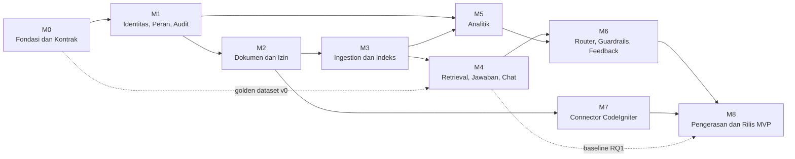

# FINAL IMPLEMENTATION ROADMAP — EKAA

| Atribut | Nilai |
|---|---|
| Versi dokumen | 1.0-draft (Gelombang 3) |
| Tanggal pembaruan | 8 November 2026 |
| Status dokumen | **READY FOR OWNER APPROVAL** |
| Dokumen terkait | `FINAL_REQUIREMENT_SPECIFICATION.md` (FR/NFR), `FINAL_SYSTEM_ARCHITECTURE.md`, `FINAL_DATABASE_DESIGN.md`, `FINAL_API_SPECIFICATION.md`, `FINAL_SECURITY_SPECIFICATION.md`, `FINAL_ACCEPTANCE_CRITERIA.md`, `PROJECT_RISK_REGISTER.md` |

## 1. Prinsip Roadmap

1. **Kontrak dulu, implementasi kemudian.** Kontrak API dan skema database disepakati pada M0 sebelum modul bergantung satu sama lain dibangun.
2. **Tidak ada modul menunggu modul lain tanpa antarmuka atau mock.** Setiap ketergantungan diberi *stub* yang jelas (bagian 4).
3. **Vertikal tipis lebih dulu.** Setelah M3 sudah ada alur menyeluruh (unggah → indeks → tanya → sitasi), lalu diperdalam.
4. **Evaluasi sejak awal.** Golden dataset mulai disusun di M0 dan baseline diukur di M4, bukan di akhir.
5. **Fitur dianggap selesai hanya bila berjalan, diuji, dan terdokumentasi** (Definition of Done global, bagian 3).

## 2. Estimasi Waktu (Hipotesis)

Estimasi di bawah mengasumsikan **satu pengembang** (AS-01). Angka adalah hipotesis kerja dengan rentang ketidakpastian sekitar ±30% dan **harus dikalibrasi ulang setelah M1** berdasarkan kecepatan aktual. Estimasi tidak boleh dipakai sebagai komitmen jadwal sebelum kalibrasi tersebut.

| Milestone | Nama | Estimasi (minggu) |
|---|---|---|
| M0 | Fondasi dan Kontrak | 3 |
| M1 | Identitas, Peran, dan Audit | 3 |
| M2 | Manajemen Dokumen dan Izin | 3 |
| M3 | Ingestion dan Indeks | 4 |
| M4 | Retrieval, Jawaban Bersitasi, dan Chat | 4 |
| M5 | Analitik Deterministik | 4 |
| M6 | Router MVP, Guardrails, dan Umpan Balik | 3 |
| M7 | Connector & Sync (CodeIgniter) | 2 |
| M8 | Pengerasan, Evaluasi, dan Rilis MVP | 3 |
| | **Total MVP** | **29 (sekitar 6,5 bulan)** |

Catatan: total ini lebih panjang daripada jadwal enam bulan pada `EKAA.docx`, padahal cakupan MVP sudah dipangkas (DEC-020). Kesenjangan itu dicatat sebagai risiko jadwal (RISK-01).

## 3. Definition of Done Global

Sebuah item dinyatakan selesai hanya jika **seluruhnya** terpenuhi:

1. Kode ada di repositori dengan riwayat commit yang jelas dan lolos tinjauan.
2. Berjalan pada lingkungan Docker Compose, bukan hanya di mesin pengembang.
3. Terintegrasi dengan backend nyata (bukan data tiruan di UI), kecuali stub yang dinyatakan eksplisit pada bagian 4.
4. Pengujian otomatis yang relevan (unit, integrasi, atau API) tersedia dan lulus pada CI.
5. Validasi masukan, otorisasi, penanganan error, dan log audit diterapkan sesuai spesifikasi.
6. Migrasi database punya `up` dan `down` yang diuji.
7. OpenAPI dan dokumentasi terkait diperbarui; `FINAL_DECISION_REGISTER.md` diperbarui bila ada keputusan baru.
8. Tidak ada rahasia di repositori; pemindaian rahasia dan dependensi pada CI lulus.
9. Acceptance criteria milestone di `FINAL_ACCEPTANCE_CRITERIA.md` terpenuhi dengan **bukti** (log uji, laporan), bukan pernyataan.

## 4. Peta Ketergantungan dan Stub

Catatan urutan: karena satu pengembang, pekerjaan dilakukan berurutan M0 → M8. M5 dan M7 dapat bergeser posisinya selama dependensinya terpenuhi.

| Ketergantungan | Stub atau antarmuka sampai modul nyata siap | Dipakai oleh |
|---|---|---|
| Layanan AI (sebelum M3) | **AI-stub**: FastAPI minimal yang memenuhi kontrak `/internal/v1/ingestions` dan memanggil callback status | M2 |
| LLM (sebelum penyedia dipilih) | **Mock LLM provider** dengan keluaran deterministik pada antarmuka LLM (DEC-013) | M4, M5, M6, pengujian CI |
| Connector (sebelum M7) | Pengunggahan manual lewat API yang sama dengan `/internal/v1/connector/items` | M2 |
| Laravel (saat M7) | Laravel nyata dari M2; **Laravel-stub** untuk uji kontrak CodeIgniter yang berjalan paralel pada CI | M7 |
| Model embedding (sebelum dikunci) | Embedding palsu deterministik untuk uji alur; dimensi dikunci setelah pemilihan model (DD-07) | M3 |

## 5. Rincian Milestone

### M0 — Fondasi dan Kontrak

| Atribut | Isi |
|---|---|
| **ID / Nama** | M0 / Fondasi dan Kontrak |
| **Tujuan** | Lingkungan kerja yang dapat direproduksi, versi terkunci, dan kontrak antarlayanan yang disepakati |
| **Modul** | Repositori, Docker Compose (app, queue, scheduler, connector, ai-api, ai-worker, PostgreSQL, Redis, MinIO, reverse proxy), CI, kerangka tiga layanan, OpenAPI awal, migrasi dasar tiga schema |
| **Dependency** | Persetujuan Owner atas keputusan yang belum APPROVED yang menghambat (terutama DEC-007, DEC-008, DEC-010, DEC-011, DEC-015) |
| **Deliverables** | Repo dan struktur direktori; `docker compose up` menjalankan seluruh layanan; kunci versi (lockfile) dan tabel versi terverifikasi (Python, FastAPI, PostgreSQL, pgvector, Redis, DuckDB, MinIO, Vue, ECharts, dukungan PHP 8.4 pada paket); OpenAPI Laravel–AI dan Laravel–Connector; role dan schema database; JWT antarlayanan prototipe; golden dataset v0 (kerangka dan pedoman penyusunan); uji ANN+filter pgvector dan perbandingan awal FTS vs ekstensi BM25 (DEC-029); pemilihan produk reverse proxy dan komponen pemindaian malware |
| **Testing** | Health check seluruh layanan; uji kontrak (stub vs OpenAPI); uji migrasi naik-turun; uji JWT (valid, kedaluwarsa, `aud` salah) |
| **Acceptance criteria** | Lihat `FINAL_ACCEPTANCE_CRITERIA.md` bagian 3, M0 |
| **Definition of Done** | DoD global + tabel versi terkunci di `FINAL_TECHNOLOGY_STACK.md` + laporan uji pgvector dan leksikal tersimpan |

### M1 — Identitas, Peran, dan Audit

| Atribut | Isi |
|---|---|
| **ID / Nama** | M1 / Identitas, Peran, dan Audit |
| **Tujuan** | Fondasi keamanan: pengguna, peran, unit kerja, token, dan audit |
| **Modul** | FR-001, FR-002, FR-003 (dasar), FR-004, FR-005, FR-006; kerangka Vue (login, panel admin pengguna) |
| **Dependency** | M0 |
| **Deliverables** | Autentikasi lengkap (login, refresh, logout, pembatasan percobaan); CRUD pengguna, peran, unit; kebijakan izin; audit log append-only dengan hak database terbatas; pengaturan sistem; panel admin pengguna terhubung API |
| **Testing** | Unit untuk Policy; uji API; uji matriks otorisasi awal; uji hak database audit (tanpa UPDATE/DELETE); uji pembatasan login |
| **Acceptance criteria** | `FINAL_ACCEPTANCE_CRITERIA.md` bagian 3, M1 |
| **Definition of Done** | DoD global; kalibrasi estimasi jadwal dicatat (RISK-01) |

### M2 — Manajemen Dokumen dan Izin

| Atribut | Isi |
|---|---|
| **ID / Nama** | M2 / Manajemen Dokumen dan Izin |
| **Tujuan** | Dokumen dapat diunggah, diberi versi, status, dan izin; sumber kebenaran ACL berada di Laravel |
| **Modul** | FR-010, FR-011, FR-012; layar admin dokumen; klien Laravel ke AI (ke AI-stub); endpoint callback status; pemindaian berkas |
| **Dependency** | M1; AI-stub |
| **Deliverables** | Unggah dan validasi server-side; versi dan status; izin per peran, unit, dan pengguna; URL unduhan bertanda tangan; sinkronisasi ACL ke AI (ke stub) dengan semantik pencabutan sinkron; rekonsiliasi dokumen harian (kerangka) |
| **Testing** | Uji validasi berkas (tipe, MIME palsu, ukuran); uji kebijakan izin; uji idempotensi unggah; uji kegagalan AI-stub (error terstruktur, data inti utuh) |
| **Acceptance criteria** | `FINAL_ACCEPTANCE_CRITERIA.md` bagian 3, M2 |
| **Definition of Done** | DoD global |

### M3 — Ingestion dan Indeks

| Atribut | Isi |
|---|---|
| **ID / Nama** | M3 / Ingestion dan Indeks |
| **Tujuan** | Layanan AI nyata mengubah dokumen menjadi chunk terindeks dengan metadata dan ACL |
| **Modul** | FR-013, FR-014; ai-api dan ai-worker; penggantian AI-stub; pemilihan model embedding (DEC-014) pada golden dataset v0 |
| **Dependency** | M2 |
| **Deliverables** | Parsing PDF berteks, DOCX, XLSX, CSV; chunking berbasis struktur dengan overlap dan parent-child; embedding dan simpan ke pgvector; indeks leksikal; `acl_principals`, `status`, `is_current`; callback status; penggantian versi mengganti indeks lama; keputusan model embedding dicatat di Decision Register |
| **Testing** | Uji parser dengan berkas sampel; uji integritas chunk (teks sama dengan sumber, metadata halaman); uji kegagalan worker (retry, status `failed`); uji penggantian versi; uji sinkronisasi dan pencabutan ACL |
| **Acceptance criteria** | `FINAL_ACCEPTANCE_CRITERIA.md` bagian 3, M3 |
| **Definition of Done** | DoD global; dimensi vektor dan parameter indeks terkunci dengan dasar pengukuran |

### M4 — Retrieval, Jawaban Bersitasi, dan Chat

| Atribut | Isi |
|---|---|
| **ID / Nama** | M4 / Retrieval, Jawaban Bersitasi, dan Chat |
| **Tujuan** | Alur tanya jawab dokumen menyeluruh dengan sitasi, abstain, dan baseline terukur |
| **Modul** | FR-015, FR-016, FR-017, FR-018; verifikasi sitasi di Laravel (DEC-025); chat UI; antarmuka LLM nyata |
| **Dependency** | M3; golden dataset v1 |
| **Deliverables** | Retrieval hibrida berfilter akses dengan RRF; reranker; generasi bersitasi dan abstain; chat UI dan riwayat; pemilihan penyedia dan model LLM berdasarkan evaluasi (DEC-013); **laporan baseline** (Recall@k, MRR, nDCG, faithfulness, akurasi sitasi; ablasi dense-saja vs hibrida vs hibrida+rerank untuk RQ1); uji kebocoran lintas hak akses awal |
| **Testing** | Evaluasi pada golden dataset; uji matriks peran × dokumen; uji pencabutan izin dan dokumen dicabut; uji abstain; uji E2E (unggah → tanya → sitasi) |
| **Acceptance criteria** | `FINAL_ACCEPTANCE_CRITERIA.md` bagian 3, M4 |
| **Definition of Done** | DoD global; laporan baseline tersimpan dengan konfigurasi dan seed yang dapat diulang; target awal ditetapkan ulang berdasarkan baseline |

### M5 — Analitik Deterministik

| Atribut | Isi |
|---|---|
| **ID / Nama** | M5 / Analitik Deterministik |
| **Tujuan** | Pertanyaan angka dijawab dengan metrik teruji, bukan hitungan LLM |
| **Modul** | FR-020 s.d. FR-025; importer DuckDB; pustaka metrik; metric planner (function calling); validator spesifikasi grafik; UI dataset, kamus data, grafik ECharts |
| **Dependency** | M1, M3 (infrastruktur worker AI), antarmuka LLM dari M4 |
| **Deliverables** | Impor CSV/XLSX dengan profil kolom; kamus data; metrik CAGR, YoY, MoM, rata-rata bergerak, proporsi, ranking, agregasi; penanganan kasus tepi (nilai awal nol/negatif, periode hilang, satuan berbeda); pemilihan metrik dari bahasa alami; grafik dari hasil hitung; izin dataset |
| **Testing** | Kasus uji deterministik per metrik termasuk kasus tepi; uji validasi skema grafik (nilai grafik = hasil hitung); uji izin dataset; uji impor dengan data galat |
| **Acceptance criteria** | `FINAL_ACCEPTANCE_CRITERIA.md` bagian 3, M5 |
| **Definition of Done** | DoD global; rumus dan sumber tampil pada setiap hasil |

### M6 — Router MVP, Guardrails, dan Umpan Balik

| Atribut | Isi |
|---|---|
| **ID / Nama** | M6 / Router MVP, Guardrails, dan Umpan Balik |
| **Tujuan** | Satu pintu tanya yang mengarahkan ke jalur yang tepat dengan perlindungan dasar |
| **Modul** | FR-019, FR-030, FR-032, FR-033 |
| **Dependency** | M4, M5 |
| **Deliverables** | Router tiga kelas dengan ambang keyakinan dan klarifikasi; guardrails (penyaringan injeksi, masking log, validasi keluaran); umpan balik jawaban dan layar tinjauan; pemindaian rahasia pada CI; rangkaian uji prompt injection v1 |
| **Testing** | Evaluasi router (precision, recall, F1 per kelas); uji injeksi; uji masking log; uji E2E dua jalur |
| **Acceptance criteria** | `FINAL_ACCEPTANCE_CRITERIA.md` bagian 3, M6 |
| **Definition of Done** | DoD global; ambang router ditetapkan dari baseline |

### M7 — Connector & Sync (CodeIgniter)

| Atribut | Isi |
|---|---|
| **ID / Nama** | M7 / Connector & Sync |
| **Tujuan** | CodeIgniter berjalan sebagai layanan terpisah yang menyerahkan berkas ke Laravel melalui kontrak teruji |
| **Modul** | FR-031; konektor folder jaringan/lokal; jadwal sinkronisasi; layar admin sumber data |
| **Dependency** | M2 (endpoint penerima di Laravel) |
| **Deliverables** | Konfigurasi sumber; kredensial terenkripsi; deteksi perubahan berbasis hash; penyerahan berkas dengan `Idempotency-Key`; riwayat sinkronisasi; penanganan item hilang; uji kontrak dua arah; **tinjauan beban pemeliharaan dua framework** (keputusan lanjut atau fallback C, melalui persetujuan Owner) |
| **Testing** | Uji kontrak CodeIgniter–Laravel; uji idempotensi; uji kegagalan sumber; uji bahwa CodeIgniter tidak dapat menetapkan izin |
| **Acceptance criteria** | `FINAL_ACCEPTANCE_CRITERIA.md` bagian 3, M7 |
| **Definition of Done** | DoD global; catatan tinjauan beban pemeliharaan masuk Decision Register |

### M8 — Pengerasan, Evaluasi, dan Rilis MVP

| Atribut | Isi |
|---|---|
| **ID / Nama** | M8 / Pengerasan, Evaluasi, dan Rilis MVP |
| **Tujuan** | MVP yang aman, terukur, dapat dipasang ulang, dan dapat didemonstrasikan |
| **Modul** | Pengujian keamanan lengkap, uji beban, uji restore, dokumentasi, demo |
| **Dependency** | M6, M7 |
| **Deliverables** | Laporan uji keamanan (otorisasi, kebocoran, injeksi, berkas, kontrak); laporan uji beban (k6 atau Locust) dengan latensi p50/p95 dan biaya per pertanyaan; uji pencadangan dan restore; skrip pemasangan dan README; dokumentasi API; studi kasus dan demo pada korpus AS-07; evaluasi pengguna awal (SUS, waktu menemukan informasi) bila peserta tersedia |
| **Testing** | Seluruh rangkaian di `FINAL_ACCEPTANCE_CRITERIA.md` bagian 6 |
| **Acceptance criteria** | Kriteria rilis MVP, `FINAL_ACCEPTANCE_CRITERIA.md` bagian 7 |
| **Definition of Done** | DoD global; seluruh kriteria rilis terpenuhi atau pengecualiannya disetujui Owner dan dicatat |

## 6. Phase 2 dan Phase 3 (Ringkas)

Rincian milestone Phase 2 dan 3 disusun setelah MVP stabil dan baseline tersedia, supaya prioritas didasarkan pada data.

| ID | Tema | Cakupan (FR) | Prasyarat |
|---|---|---|---|
| P2-A | Analitik lanjut | FR-040 (text-to-SQL), FR-046 (row-level) | MVP stabil; uji keamanan SQL siap |
| P2-B | Kualitas jawaban | FR-041, FR-043, FR-044, FR-048 | Baseline M4 dan M6 |
| P2-C | Dokumen sulit | FR-042 (OCR dan tabel PDF) | Korpus pindai tersedia |
| P2-D | Konektor dan operasi | FR-045, FR-047, FR-049 | Keputusan lanjut CodeIgniter (M7) |
| P3-A | Enterprise | FR-050 (SSO), FR-054 (provisioning, Helm) | Kebutuhan klien nyata |
| P3-B | Antarmuka tambahan dan opsional | FR-051, FR-052, FR-053 | Studi kasus kedua |

## 7. Jalur Paralel: Penelitian (Track C)

Jalur ini berjalan di samping milestone, **tanpa mencampur klaim hasil dengan dokumen keputusan proyek** (DEC-023).

| Waktu | Aktivitas | Keluaran | Catatan integritas |
|---|---|---|---|
| M0–M1 | Tinjauan pustaka terverifikasi (DOI, penerbit, indeksasi Scopus/SINTA); pemetaan penelitian terdahulu; perumusan research gap | Matriks literatur; draf gap | Tidak ada referensi tanpa verifikasi; novelty tidak diklaim berlebihan |
| M0–M4 | Penyusunan golden dataset v0 → v1 dengan pedoman anotasi | Dataset dan pedoman | Sumber dokumen boleh dipublikasikan atau disintesis (AS-07) |
| M4 | Eksperimen baseline RQ1 (dense vs hibrida vs hibrida+rerank) | Laporan eksperimen dengan konfigurasi dan seed | Hasil dilaporkan apa adanya, termasuk hasil negatif |
| M5 | RQ2: LLM dengan alat hitung deterministik vs LLM tanpa alat | Laporan eksperimen | Kondisi pembanding setara |
| M4–M8 | RQ3: pengaruh retrieval sadar hak akses | Laporan kebocoran dan kualitas | Skenario uji dipublikasikan |
| Setelah M8 | Penulisan manuskrip: judul Inggris, isi Indonesia, IMRAD, sekitar 2.500 kata, sitasi IEEE | Draf manuskrip | Disesuaikan dengan ketentuan jurnal tujuan |

## 8. Gerbang Keputusan

| Gerbang | Waktu | Keputusan yang diminta dari Owner |
|---|---|---|
| G0 | Sebelum M0 | Persetujuan keputusan yang masih PENDING (DEC-001, 005, 007–016, 018–023) |
| G1 | Akhir M1 | Kalibrasi jadwal; lanjut atau pangkas cakupan |
| G2 | Akhir M4 | Penetapan target dari baseline; pemilihan LLM dan embedding |
| G3 | Akhir M7 | Lanjut dengan CodeIgniter atau fallback C (DEC-002 catatan 4.1) |
| G4 | Akhir M8 | Persetujuan rilis MVP dan perencanaan Phase 2 |

## 9. Riwayat Perubahan

| Versi | Tanggal | Perubahan |
|---|---|---|
| 1.0-draft | 2026-11-08 | Penyusunan awal Gelombang 3 |
