# FINAL SYSTEM ARCHITECTURE — EKAA

| Atribut | Nilai |
|---|---|
| Versi dokumen | 1.0-draft (Gelombang 2) |
| Tanggal pembaruan | 8 November 2026 |
| Status dokumen | **READY FOR OWNER APPROVAL** |
| Landasan keputusan | DEC-001 s.d. DEC-023 (lihat `FINAL_DECISION_REGISTER.md`); keputusan tambahan DEC-024 s.d. DEC-030 berstatus PROPOSED |
| Dokumen terkait | `FINAL_TECHNOLOGY_STACK.md`, `FINAL_REQUIREMENT_SPECIFICATION.md`, `FINAL_DATABASE_DESIGN.md`, `FINAL_API_SPECIFICATION.md`, `FINAL_SECURITY_SPECIFICATION.md` |

## 1. Fakta, Asumsi, dan Batas Dokumen

**Fakta (dari keputusan Owner yang berstatus APPROVED):** Laravel 13 sebagai core backend dan identity provider tunggal; CodeIgniter 4.7.x sebagai Connector & Sync Service; Python FastAPI sebagai layanan AI; PHP 8.4; Keycloak ditunda.

**Asumsi baru (diberi label, belum dikonfirmasi Owner):**

| ID | Asumsi |
|---|---|
| AS-06 | Lingkungan demo: satu server lokal atau VPS dengan Docker Compose |
| AS-07 | Korpus golden dataset: dokumen kampus yang boleh dipublikasikan atau disintesis |
| AS-08 | Reverse proxy (Caddy atau Nginx) dipakai untuk TLS dan routing (DEC-024, PROPOSED) |

Dokumen ini mendefinisikan **rancangan**, bukan klaim bahwa sistem sudah dibangun atau diuji.

## 2. Prinsip Arsitektur

1. **Satu pemilik per fakta.** Identitas dan hak akses hanya dimiliki Laravel. Chunk dan vektor hanya dimiliki layanan AI. Konfigurasi dan status konektor hanya dimiliki CodeIgniter.
2. **Laravel adalah satu-satunya gerbang dari klien.** Browser tidak pernah memanggil CodeIgniter atau FastAPI.
3. **Pertahanan berlapis untuk akses data.** Filter akses diterapkan di retrieval (FastAPI) **dan** diverifikasi ulang oleh Laravel pada sitasi sebelum respons dikirim.
4. **LLM tidak menghitung angka.** Semua angka berasal dari fungsi metrik teruji atau hasil query tervalidasi.
5. **Kegagalan terisolasi.** Layanan AI atau konektor mati tidak menghentikan autentikasi, manajemen dokumen, dan audit.

## 3. System Context Diagram

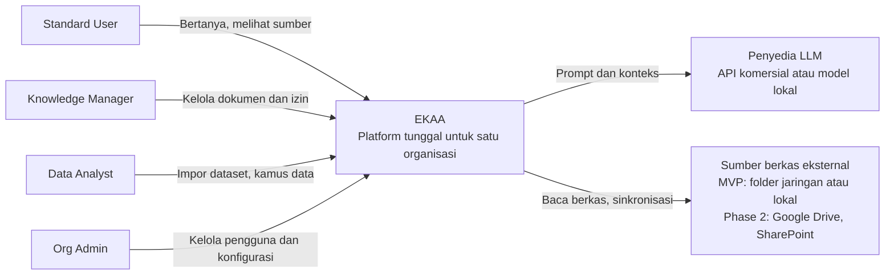

## 4. Container Diagram

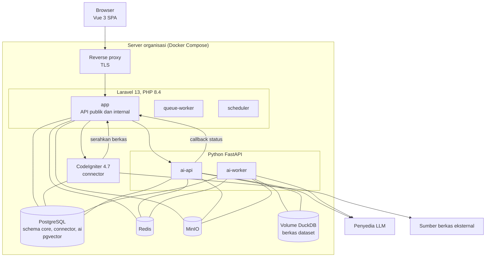

Catatan: `ai-api` dan `ai-worker` memakai basis kode yang sama dan peran proses berbeda. Panah putus-nyambung `---` berarti akses data sesuai batas kepemilikan schema di bagian 8, bukan akses bebas.

## 5. Application Architecture

| Aplikasi | Pemilik | Tanggung jawab | Tidak boleh |
|---|---|---|---|
| Vue 3 SPA | Frontend | UI chat, panel admin, grafik ECharts | Menyimpan rahasia; memanggil layanan selain Laravel |
| Laravel (`app`) | Core | Autentikasi, otorisasi, metadata dokumen dan dataset, percakapan, audit, orkestrasi, penegakan akses | Menjalankan embedding, retrieval, atau perhitungan metrik |
| Laravel (`queue-worker`, `scheduler`) | Core | Tugas latar: kirim ke AI, rekonsiliasi, retensi | — |
| CodeIgniter (`connector`) | Connector | Konfigurasi konektor, jadwal, deteksi perubahan, penyerahan berkas ke Laravel | Mengelola pengguna, peran, izin, atau menjawab pertanyaan |
| FastAPI (`ai-api`) | AI | Router, retrieval, rerank, generasi, metric engine, validasi grafik | Menyimpan identitas atau memutuskan izin |
| FastAPI (`ai-worker`) | AI | Parsing, chunking, embedding, impor dataset | — |

## 6. Backend Architecture (Laravel)

Struktur lapisan: **Controller (tipis) → Form Request (validasi) → Service/Action (business logic) → Repository/Eloquent → Policy/Gate (otorisasi)**. Controller tidak memuat business logic.

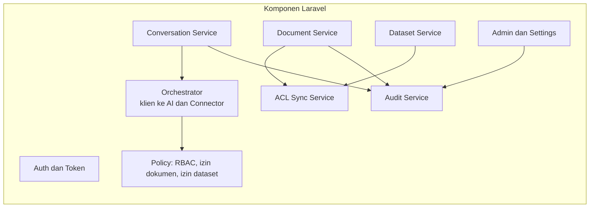

Aturan implementasi: setiap endpoint melewati middleware autentikasi, policy, validasi, dan pencatatan audit untuk aksi yang bersifat sensitif. Kode error mengikuti `FINAL_API_SPECIFICATION.md`.

## 7. AI Service Architecture

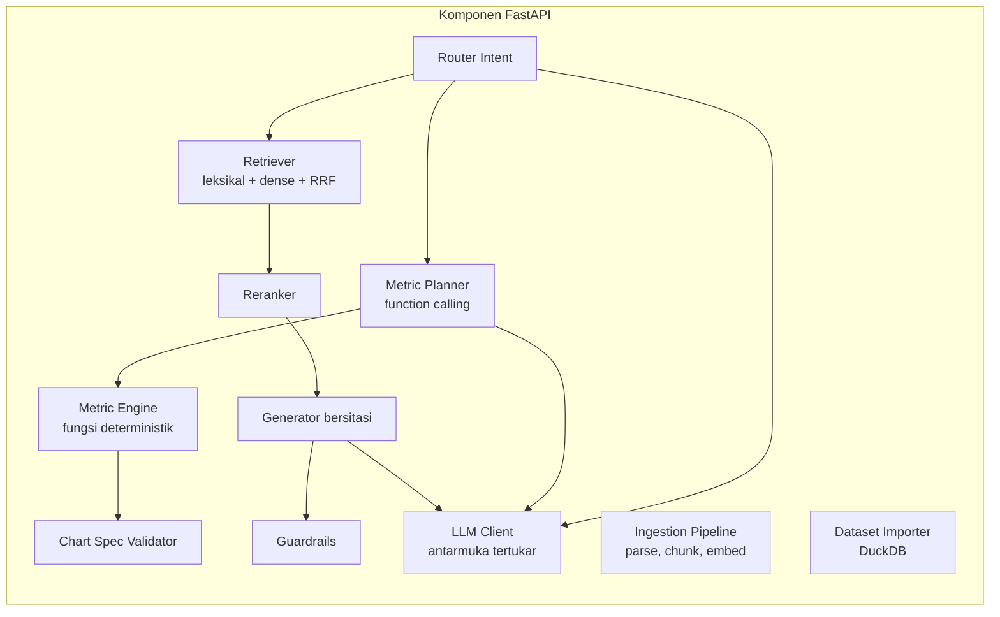

Antarmuka LLM (DEC-013) berupa kelas abstrak dengan implementasi per penyedia; pemilihan lewat konfigurasi instalasi. Setiap panggilan LLM mencatat model, versi prompt, dan parameter (NFR-AUD-001, NFR-REP-001).

## 8. Database Architecture (Ringkasan)

Satu PostgreSQL, tiga schema, tiga role. Rincian ada di `FINAL_DATABASE_DESIGN.md`.

| Schema | Pemilik | Isi |
|---|---|---|
| `core` | Laravel | Identitas, peran, dokumen, dataset (metadata), percakapan, audit, pengaturan |
| `connector` | CodeIgniter | Konfigurasi sumber, sinkronisasi, item sumber |
| `ai` | FastAPI | Chunk, embedding, status indeks, jejak retrieval, evaluasi |

Aplikasi tidak melakukan join lintas schema. Referensi lintas layanan memakai UUID tanpa foreign key dan dijaga oleh rekonsiliasi terjadwal.

## 9. Data Flow Diagram (Level 1)

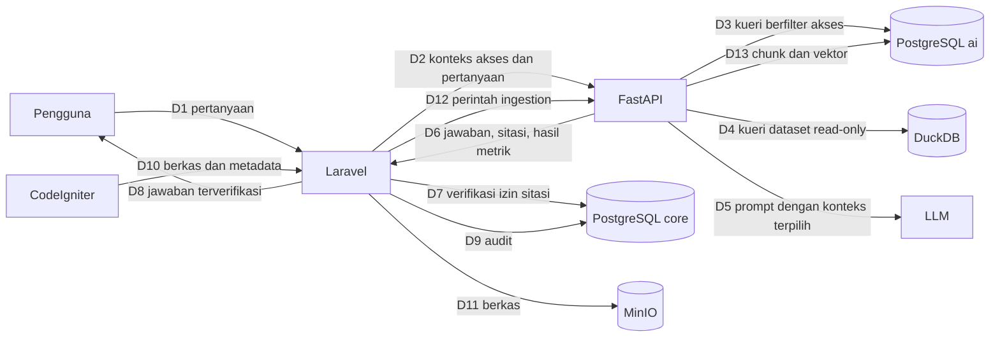

## 10. RAG Pipeline

### 10.1 Alur ingestion

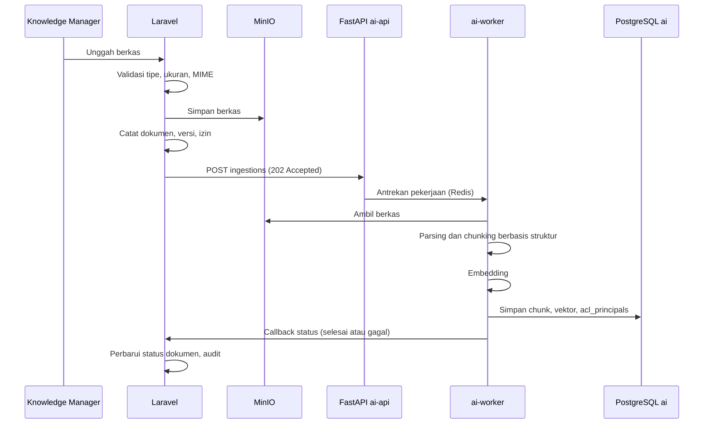

### 10.2 Alur kueri dokumen

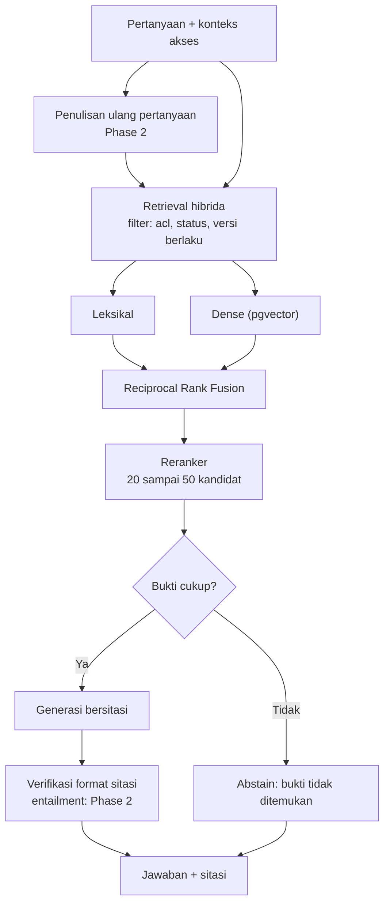

Ketentuan: filter akses, status, dan versi berlaku diterapkan sebagai klausa `WHERE` pada kedua jalur pencarian. **Risiko yang harus diuji:** pencarian vektor perkiraan (ANN) dengan filter dapat mengembalikan lebih sedikit hasil dari yang diminta. Mitigasi (iterative scan pada versi pgvector yang mendukung, atau pencarian dengan kandidat lebih besar) diverifikasi pada M0 sesuai versi pgvector yang dikunci.

Pencarian leksikal pada PostgreSQL bawaan memakai `ts_rank`, **bukan BM25 murni**, dan tidak ada konfigurasi bahasa Indonesia bawaan. Lihat DEC-029.

## 11. Analytics Pipeline

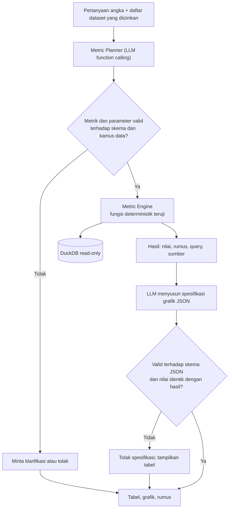

Text-to-SQL (FR-040) **tidak ada di MVP**. Pada Phase 2 ia menjadi jalur cadangan dengan validasi parser (hanya `SELECT`), eksekusi read-only, batas waktu, dan koreksi diri.

## 12. Hybrid Routing

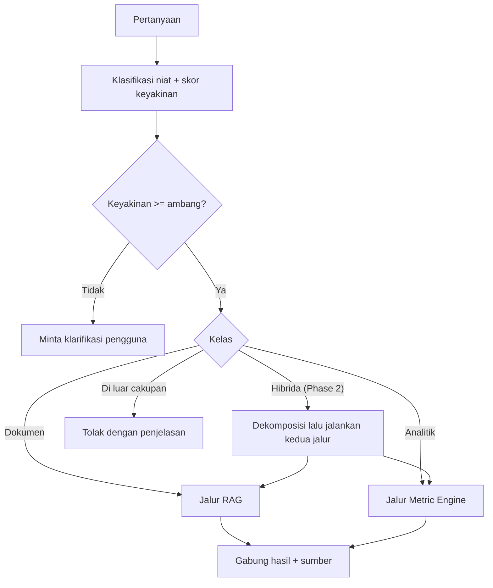

Pada MVP hanya tiga kelas (dokumen, analitik, di luar cakupan). Ambang keyakinan ditetapkan dari baseline pada golden dataset, bukan angka tebakan.

## 13. Authentication and Authorization

- **Pengguna → Laravel:** kredensial; kata sandi di-hash dengan algoritma yang kuat (Argon2id); token akses berumur pendek dan token penyegar (refresh) yang dapat dicabut; pembatasan percobaan login.
- **Laravel → CodeIgniter/FastAPI:** JWT layanan berumur pendek (DEC-030). Konteks pengguna dikirim sebagai klaim `principals`, bukan kredensial pengguna.
- **CodeIgniter → Laravel:** JWT layanan yang ditandatangani CodeIgniter sendiri.
- **Otorisasi dokumen:** sumber kebenaran adalah `core.document_permissions`. Salinan denormalisasi `acl_principals` pada chunk di schema `ai` disinkronkan oleh Laravel (DEC-025). Pencabutan izin diproses **sinkron sebelum Laravel mengembalikan sukses ke pengguna**; pemberian izin boleh asinkron.
- **Pertahanan berlapis:** sebelum jawaban dikirim, Laravel memeriksa setiap `document_id` pada sitasi terhadap Policy. Sitasi yang tidak lolos dibuang dan kejadian dicatat sebagai anomali keamanan.

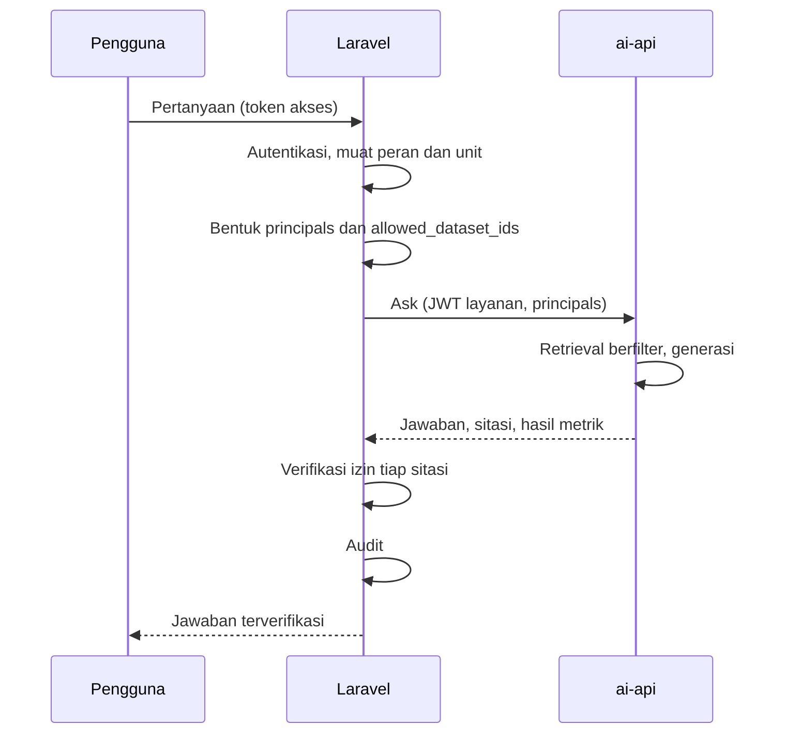

## 14. File Processing

| Tahap | Pemilik | Kontrol |
|---|---|---|
| Penerimaan | Laravel | Batas ukuran, daftar tipe yang diizinkan, cek MIME dan magic bytes di server, nama berkas dinormalisasi, penyimpanan di bucket privat |
| Pemindaian | Laravel | Pemindaian malware (kandidat ClamAV; **keputusan komponen dan versi diverifikasi pada M0**) |
| Parsing | ai-worker | Berjalan terisolasi, batas waktu dan memori; tidak mengeksekusi makro; PDF berteks, DOCX, XLSX, CSV pada MVP |
| Chunking | ai-worker | Berbasis struktur (judul, pasal, ayat) dengan overlap; metadata halaman dan bagian wajib |
| Indeks | ai-worker | Chunk dengan `acl_principals`, `status`, `is_current` |
| Dataset | ai-worker | Tipe kolom divalidasi; disimpan di DuckDB; laporan baris galat |
| Konektor | CodeIgniter | Hash isi untuk deteksi perubahan; kunci idempoten; penyerahan ke Laravel melalui API |

Isi dokumen diperlakukan sebagai **data tidak tepercaya** (lihat `FINAL_SECURITY_SPECIFICATION.md` bagian 7).

## 15. Security Architecture (Ringkasan)

Zona jaringan: **publik** (hanya reverse proxy), **aplikasi** (Laravel, CodeIgniter, FastAPI), **data** (PostgreSQL, Redis, MinIO). Hanya reverse proxy yang menerima trafik dari luar; layanan lain berada di jaringan internal Docker. Detail kontrol, threat model, dan UU PDP ada di `FINAL_SECURITY_SPECIFICATION.md`.

## 16. Deployment Architecture

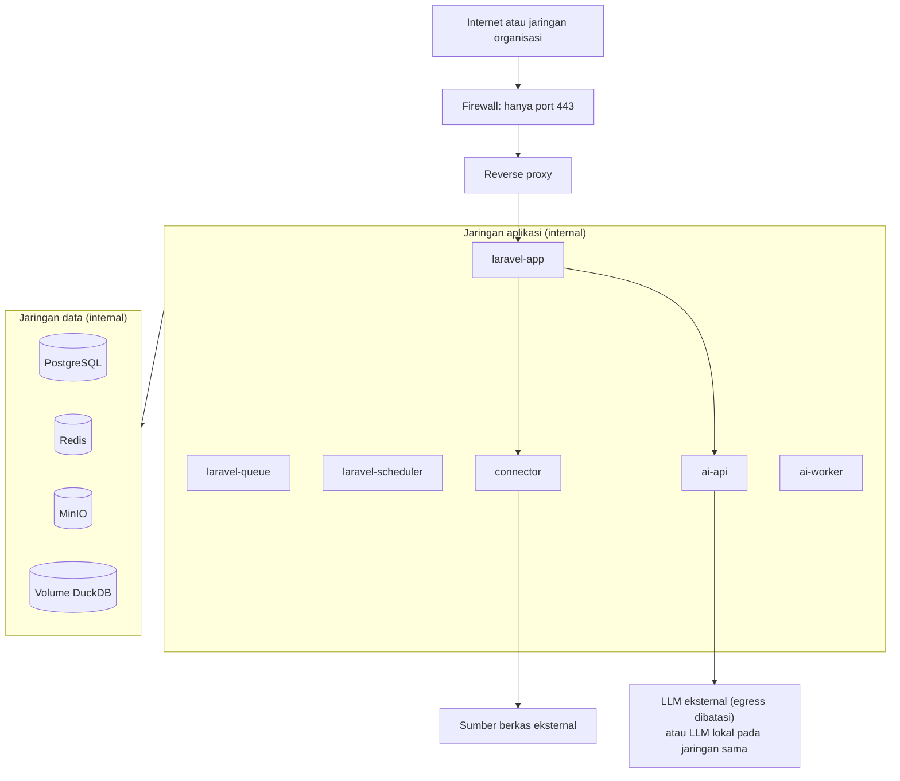

Ketentuan deployment (DEC-015): Docker Compose; konfigurasi per instalasi melalui berkas `.env` dan rahasia terpisah; migrasi dijalankan per layanan oleh pemiliknya; versi image dikunci; egress keluar hanya untuk LLM dan sumber konektor yang dikonfigurasi. Opsi LLM lokal memerlukan perangkat keras yang belum ditentukan (bergantung DEC-013 dan lingkungan demo).

## 17. Ketergantungan dan Keputusan Baru yang Diusulkan

| ID | Topik | Rekomendasi | Status |
|---|---|---|---|
| DEC-024 | Reverse proxy | Caddy atau Nginx untuk TLS dan routing | PROPOSED |
| DEC-025 | Sinkronisasi hak akses ke retrieval | Denormalisasi `acl_principals` pada chunk; pencabutan sinkron | PROPOSED |
| DEC-026 | Kunci primer | UUIDv7 dibangkitkan aplikasi | PROPOSED |
| DEC-027 | Tabel `organizations` | Tidak dibuat (single-tenant); profil organisasi di `system_settings` | PROPOSED |
| DEC-028 | Kontrak ingestion | HTTP 202 ke AI, status kembali lewat callback ke Laravel; bukan antrean yang dibagi lintas bahasa | PROPOSED |
| DEC-029 | Pencarian leksikal | PostgreSQL FTS (konfigurasi `simple`) sebagai baseline; ekstensi BM25 dievaluasi pada M0 atau M1 | PROPOSED |
| DEC-030 | JWT antarlayanan | Penerbit menandatangani JWT sendiri dengan kunci asimetris; penerima menyimpan kunci publik; `aud` dan masa berlaku di bawah 5 menit | PROPOSED |

## 18. Riwayat Perubahan

| Versi | Tanggal | Perubahan |
|---|---|---|
| 1.0-draft | 2026-11-08 | Penyusunan awal Gelombang 2 |
